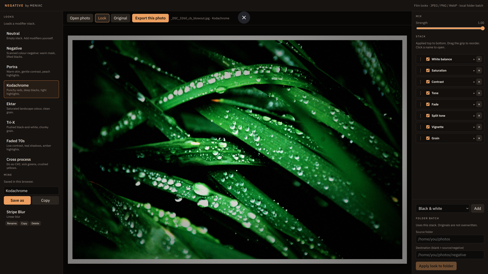

# NEGATIVE

Film-style looks for ordinary photos. Design on one JPEG/PNG/WebP, then apply the same recipe to a whole folder.

NEGATIVE by MENiAC. No RAW. No video. Local-only — the batch route talks to your filesystem and only accepts requests from this machine.



## What you can do

- Open a photo, pick a built-in look, then add / reorder / tweak modifiers.
- Built-in looks: Neutral, Negative, Portra, Kodachrome, Ektar, Tri-X, Faded 70s, Cross process.
- **Mine**: save, rename, duplicate and delete your own looks. They live in this browser (`localStorage`), not in a file.
- Stack modifiers (only stacked effects run): white balance, saturation, brightness, contrast, fade, tone, vignette, grain, black & white, split tone, **radial blur**, **linear blur**, **border**, **light leak**.
- Radial blur uses a disc mask (sharp centre). Linear blur is a rotatable band (tilt-shift). Drag Center / Shift sliders to see a gizmo on the photo; it hides on mouse up.
- Border scales the photo into the frame: **Print** (even paper), **Polaroid** (thick bottom), **Film** (rebate + sprockets). Tone is paper / stock (white → black); Warmth tints it cream.
- Light leak fogs the frame like light hit the film: **Edge**, **Corner**, or **Streak**. Color is yellow → orange → red → magenta. Drag Center to place it.
- Export the current photo, or apply the current stack to a folder. Originals are never overwritten.
- Scroll the preview to zoom, drag to pan when zoomed. The percentage (or double-click) fits the whole photo.

## Requirements

- Node.js 22+ (20 may work)
- npm 10+
- Linux is the intended home. macOS/Windows should run; folder batch needs a real filesystem path.

`sharp` (decode/encode) and `esbuild` need install scripts. This repo lists them in `package.json` under `allowScripts`.

## Install

```bash
cd NEGATIVE
npm install
```

If `sharp` did not build (preview/export then fail with a native-module error):

```bash
npm install-scripts approve sharp esbuild
npm rebuild sharp
```

## Develop

```bash
npm run dev
```

Open [http://127.0.0.1:8084](http://127.0.0.1:8084). Bound to localhost on port **8084**.

```bash
npm run check
```

Typechecks the SvelteKit app.

## Build and run

Production build uses `@sveltejs/adapter-node` (the UI is a browser app, but export/batch need Node + the filesystem). Output is `build/`.

```bash
npm run build
npm start
```

`start` runs `node build` on [http://127.0.0.1:8084](http://127.0.0.1:8084). Adapter-node defaults to port 3000 if you call `node build` yourself — pass `PORT` / `HOST` to override:

```bash
PORT=8084 HOST=127.0.0.1 node build
```

`npm run preview` serves the Vite preview of the client on 8084. Use `npm start` (or `node build`) when you want folder batch and export to work the same as production.

## How it is put together

| Path | Role |
|---|---|
| `src/lib/grade.ts` | Pixel engine. Point effects per pixel; blur, border and light leak are whole-buffer passes. |
| `src/lib/blur.ts` | Masked gaussian-ish blur (radial disc / linear band). |
| `src/lib/border.ts` | Print / Polaroid / film rebate (photo scaled into the frame). |
| `src/lib/leak.ts` | Analog light leak (edge / corner / streak, screen-blended). |
| `src/lib/modifiers.ts` | Catalogue of addable effects (labels, defaults). |
| `src/lib/presets.ts` | Built-in named stacks. Clicking one copies that stack into the editor. |
| `src/lib/userLooks.ts` | Save / load user looks in `localStorage`. |
| `src/lib/types.ts` | `Modifier`, `GradeSettings`, `Look`. |
| `src/lib/preview.ts` | Downscale + live/HQ canvas preview. |
| `src/lib/server/` | sharp decode/encode, folder walk, localhost check, settings parse. |
| `src/routes/api/export` | One uploaded file → graded download. |
| `src/routes/api/batch` | Source folder → destination folder. Originals are never overwritten. |

A look is a named stack of modifiers. Add only the effects you need; each one has its own sliders. Export and folder batch send the current stack. Order is apply order (top to bottom). Collapse is UI-only and is not saved.

Preview grades a small live raster while a slider moves, then a sharper pass after it settles, drawn at a fixed frame size so the picture does not jump.

## License

MIT. See `LICENSE`.
